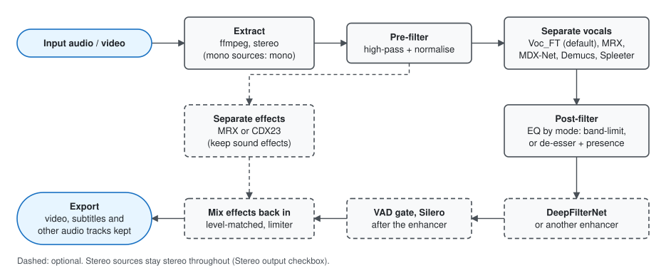

<div align="center">


# Music Assassin

**Background music remover for long videos and audio. Offline, CPU-only, keeps the dialogue and the sound effects.**

[](https://github.com/mAbEngineers/Music-Assassin/releases)
[](https://github.com/mAbEngineers/Music-Assassin/releases)
[](LICENSE)


**[Releases](https://github.com/mAbEngineers/Music-Assassin/releases) · [Changelog](CHANGELOG.md) · [Documentation](docs/) · [Issues](https://github.com/mAbEngineers/Music-Assassin/issues) · [Live App](https://github.com/mAbEngineers/music-assassin-live)**

</div>

Point it at a TV episode, a movie, a podcast, or any audio/video file with
background music over the dialogue, and it removes the music — using
open-source AI separation models, entirely offline. No cloud services, no
paid APIs, no GPU required.

Use it to **remove background music from a video**, strip music from a
podcast, lecture or documentary, or isolate dialogue and sound effects from a
movie or TV episode. It is a free, open-source (MIT) alternative to cloud
"vocal remover" and "music remover" services, for Windows and Linux.

> **Sibling repo:** [`music-assassin-live`](https://github.com/mAbEngineers/music-assassin-live)
> is the real-time app for Linux and Windows: a "volume booster" that strips
> music from whatever the device is playing, no manual routing. This repo
> works on files; that one works on live playback. This repo is also the
> research lab where separation models get tested and benchmarked before
> being promoted there.

---

## Highlights

- **Fast** — the OpenVINO-accelerated engine processes a 10-minute episode in about **58 seconds** on a 16-core CPU (down from ~225 s through the older pipeline).
- **Keep the sound effects** — an optional pass extracts footsteps, impacts, and ambience separately and mixes them back in after the music is gone.
- **A real model library, not one model** — Demucs, MDX-Net/UVR, Spleeter, and two dialogue/music/effects separators (MRX, CDX23) are all selectable, with VAD gating and a learned cleanup pass on top. See the [full lineup](#model-library) below.
- **Fully offline, CPU-only** — every model runs locally once downloaded; nothing leaves your machine.
- **Stereo in, stereo out** — stereo and surround sources come out in stereo, and kept sound effects keep their left/right placement (on `main`, in the next release).
- **Turn the music down, not off** — a music level control adds the removed music back at -20 or -12 dB if a hard cut sounds unnatural (on `main`).
- **Made for non-technical users** — a three-step window with plain-language choices, a 20-second preview before a full export, and settings that are remembered (on `main`).
- **Video-aware** — subtitles are kept, and the video stream passes through untouched instead of being re-encoded.
- **Batch** — queue a folder of files and let it run.

---

## Model library

Music Assassin isn't built on one separator — it ships a selectable library of
them, so you can trade speed for quality (or vice versa) per file.

| Model | Role | Size | Notes |
|---|---|---|---|
| **Voc_FT · fast engine** (OpenVINO) | Default separator | 66 MB | Same weights as MDX-Net Voc_FT, ~7–12× faster via OpenVINO BF16/onnxruntime |
| **MRX dialogue** | Fastest separator | 31 MB | Dialogue/music/effects in one pass, int8 ONNX, MIT-licensed |
| **CDX23** | Quality effects separator | ~80 MB | Best sound-effects retention of anything tested; used for "Keep effects: Quality" |
| **MDX-Net Voc_FT / Kim_Vocal_2** | Vocals-only specialists | 66–130 MB | Via `audio-separator`; the pre-fast-engine default |
| **DEMUCS** htdemucs / htdemucs_ft / mdx_extra | General 4-stem separation | 80 MB–320 MB | Meta Research; natural-sounding, INT8-quantized option |
| **Spleeter** | Legacy 4-stem fallback | ~150 MB | Fastest to load, lowest separation quality of the engines here |
| **Silero VAD** | Silence gate | ~1 MB | Silences gaps between lines where leftover music bleeds through |
| **DeepFilterNet** (optional) | Post-separation cleanup | small | Learned speech enhancer for residual noise/artifacts |

The repo also doubles as a research lab: **20+ separation and speech-enhancement
models** have been benchmarked here, even where they didn't make the cut for
the app. See
[`docs/COMPREHENSIVE_METHOD_COMPARISON.md`](docs/COMPREHENSIVE_METHOD_COMPARISON.md)
for the full table.

> **Know the limits.** Speech-enhancement models (DeepFilterNet, GTCRN, DTLN,
> MetricGAN+, …) clean up noise but **do not remove music** — they're trained
> on speech-vs-noise, so they treat music as speech. Only the separators in
> the table above (Demucs/MDX-Net/MRX/CDX23/Spleeter class) actually remove
> it. Details in [`docs/COMPREHENSIVE_METHOD_COMPARISON.md`](docs/COMPREHENSIVE_METHOD_COMPARISON.md).

---

## Pipeline

How a file actually moves through the app on `main` (default settings;
optional stages are dashed). Verified against the current processing code,
not just the docstrings.



The VAD gate deliberately runs *after* the cleanup pass, not before —
DeepFilterNet needs a continuous signal to build its noise model, and gating
first would fragment the audio. The effects branch only runs when "keep
sound effects" is on: MRX or CDX23 separates an effects stem from the same
pre-filtered audio, after the vocal pass, and it is mixed back in last so
sounds between lines survive the gate. The released v0.4.5 has the same
stages, but is mono throughout and its pre-filter still has a −40 dB noise
gate. On `main` a music-level control can also add the separated-out music
back, quietly, at the same final mix stage as the effects (not drawn in the
diagram).

This pipeline has grown in stages since v0.0.1 (raw Spleeter, no filtering
at all); see [`docs/PIPELINE_EVOLUTION.md`](docs/PIPELINE_EVOLUTION.md) for
a diagram of every version where the shape of it changed.

---

## Download

Prebuilt, ready to run — no Python install needed.

| Platform | File | Size |
|---|---|---|
| **Windows** 10/11 (x64) | [`MusicAssassin_v0.4.5.exe`](https://github.com/mAbEngineers/Music-Assassin/releases/download/v0.4.5/MusicAssassin_v0.4.5.exe) | ~589 MB |
| **Ubuntu / Debian** (x64) | [`MusicAssassin_v0.4.5.deb`](https://github.com/mAbEngineers/Music-Assassin/releases/download/v0.4.5/MusicAssassin_v0.4.5.deb) | ~1.1 GB |
| **Linux** (x64, portable) | [`MusicAssassin_v0.4.5`](https://github.com/mAbEngineers/Music-Assassin/releases/download/v0.4.5/MusicAssassin_v0.4.5) | ~1.1 GB |

- **Windows** — run the `.exe` directly, no install.
- **Debian/Ubuntu** — `sudo dpkg -i MusicAssassin_v0.4.5.deb`, then run `music-assassin`.
- **Linux portable** — `chmod +x MusicAssassin_v0.4.5 && ./MusicAssassin_v0.4.5`.

The fast engine (Voc_FT), MRX, and CDX23 are bundled — about 151 MB — so
separation and sound-effect keeping both work offline from the first run.
Demucs, Spleeter, and the alternate MDX-Net models download once on first
use. [All releases](https://github.com/mAbEngineers/Music-Assassin/releases)

---

## Run from source

```bash
git clone https://github.com/mAbEngineers/Music-Assassin.git
cd Music-Assassin

uv python install 3.12
uv venv $HOME/.venvs/music-assassin --python 3.12
source $HOME/.venvs/music-assassin/bin/activate

bash setup_v044.sh $HOME/.venvs/music-assassin   # installs deps + downloads models

python MusicAssassinGUI_v0.4.5.py
```

DeepFilterNet needs a Rust toolchain: `curl https://sh.rustup.rs | sh -s -- -y`

Older Python, or want the three-separator build without the newer cleanup
stages? See the full per-version install matrix in
[`CHANGELOG.md`](CHANGELOG.md). Older GUIs live in [`versions/`](versions/).

### Basic usage

1. Press **Add files** and choose videos or audio. Each file gets an x to take it back out.
2. Choose what you want:
   - **Music:** remove it, or turn it down a lot (-20 dB) or a little (-12 dB) instead of deleting it.
   - **Sound effects:** remove them with the music, or keep them (fast or best quality).
   - **Quality:** Best (recommended), Faster or Fastest.
   - **Keep stereo sound:** on by default.
3. Press **Preview 20 s** to try the settings on a 20-second excerpt first. **Hear original** and **Hear result** open both in your default player.
4. Press **Start**. **Stop** finishes the file in progress and then stops.
   Everything technical (separation engine, strength, voice cleanup, VAD gate and so on) is under **Advanced settings**, and your choices are remembered between sessions.
5. The output lands as `{filename}-vocals.{extension}` next to the source file.

---

## Requirements

- **Python 3.9–3.12** (3.12 tested) to run from source.
- **FFmpeg** — system package, not pip (`apt install ffmpeg` / `brew install ffmpeg`).
- **Rust toolchain** — only if you want DeepFilterNet cleanup.
- CPU-only; no GPU/CUDA needed anywhere in the pipeline.
- Installing by hand instead of with `setup_v044.sh`: install `torch`, `torchaudio` and
  `torchvision` first, together, from one index (`--index-url https://download.pytorch.org/whl/cpu`).
  A CPU torch next to PyPI's CUDA torchvision stops MDX-Net from loading
  ("operator torchvision::nms does not exist").

Exact per-version Python/dependency matrix: [`CHANGELOG.md`](CHANGELOG.md) and
[`requirements/REQUIREMENTS_GUIDE.md`](requirements/REQUIREMENTS_GUIDE.md).

---

## FAQ

**How do I remove background music from a video?** Download the Windows
`.exe` or the Linux `.deb` from the [Download](#download) section, add your
video, and run it. The video stream passes through untouched and subtitles are
kept.

**Does it work offline, without a GPU?** Yes. Everything runs locally on the
CPU; nothing is uploaded. The fast engine uses OpenVINO.

**Can it keep the sound effects?** Yes. An optional pass extracts footsteps,
impacts and ambience separately and mixes them back in.

**How is this different from Ultimate Vocal Remover or Demucs?** It uses
models from that family (MDX-Net/UVR, Demucs) and adds a pipeline around them
for long files: a faster OpenVINO engine, sound-effect keeping, silence
gating, batch queueing and video handling.

**Why not a noise suppressor like DeepFilterNet, RNNoise or Krisp?** Those
remove noise, not music; they treat music as speech. See the
[limits note](#model-library).

**Can I remove music from live audio instead of a file?**
Use [Music Assassin Live](https://github.com/mAbEngineers/music-assassin-live).

---

## Research & roadmap

This repo is also the research lab behind the model choices above:

- [`HANDOVER.md`](HANDOVER.md) — current branch state, how to run/verify it, open issues.
- [`docs/ROADMAP.md`](docs/ROADMAP.md) — direction, candidates, open decisions.
- [`docs/COMPREHENSIVE_METHOD_COMPARISON.md`](docs/COMPREHENSIVE_METHOD_COMPARISON.md) — every model/technique tried, in one table.
- [`docs/OFFLINE_SPEED_RESEARCH.md`](docs/OFFLINE_SPEED_RESEARCH.md) — how the pipeline got under a minute per 10 minutes of audio.
- [`docs/LIVE_APP_PLAN.md`](docs/LIVE_APP_PLAN.md) — why a sibling repo, [`music-assassin-live`](https://github.com/mAbEngineers/music-assassin-live), exists for the real-time/streaming version.

---

## Contributing

Feedback and PRs welcome. On the near-term list:
- GPU acceleration toggle
- SCNet / RoFormer models for higher-quality separation
- A real-time-capable separator for the live app

---

## Acknowledgments

- **Demucs** — Meta Research
- **Spleeter** — Deezer Research
- **audio-separator / UVR** — NomadKaraoke / Anjok07
- **DeepFilterNet** — Rikorose
- **Silero VAD** — Silero Team
- **sherpa-onnx** — k2-fsa
- **OpenVINO** — Intel
- **MRX** — Mitsubishi Electric Research Labs
- **CDX23** — ZFTurbo / Sound Demixing Challenge 2023
- **FFmpeg**
- **SciPy**

---

<div align="center">

MIT licensed — see [LICENSE](LICENSE).

*Fast Voc_FT engine · Demucs · Spleeter · MDX-Net · VAD gating · optional DeepFilterNet cleanup · optional sound-effect keeping*

</div>
