# Pipeline Evolution

One diagram per version where the audio-processing pipeline's actual
**shape** changed — stages added, removed, reordered, or export restructured.
Versions that kept the same shape as their predecessor (e.g. v0.3.4 over
v0.3.3, v0.4.2 over v0.4.1, v0.5.1 over v0.5.0) are folded into that
predecessor's entry with a note on what was actually new.

**Every diagram here was built by reading the real per-file processing
function, not from docstrings, module comments, or `HANDOVER.md`/`README.md`
prose.** That distinction matters: two versions in this history have a
code/comment mismatch (flagged below), where the stated pipeline is not the
one that runs. For the current pipeline in everyday terms, see the README's
[Pipeline section](../README.md#-pipeline); this document is the full,
version-by-version derivation behind it.

## Legend

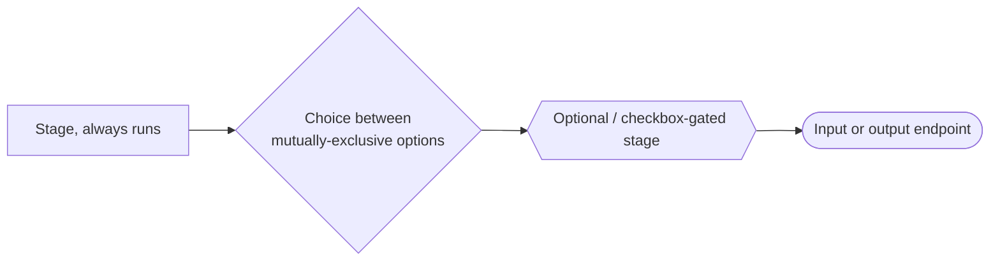

## A note on "threading"

Several versions (v0.4.1 through v0.5.1) wrap each separation chunk in a
`threading.Thread`. In every case the main loop calls `.join()` on that
thread before starting the next chunk — so despite the thread, chunks still
process strictly one after another. The thread exists only so the progress
bar can repaint while a chunk runs, not for real concurrency. Treat every
"chunked" stage below as sequential unless noted otherwise.

---

## v0.0.1 — first working prototype

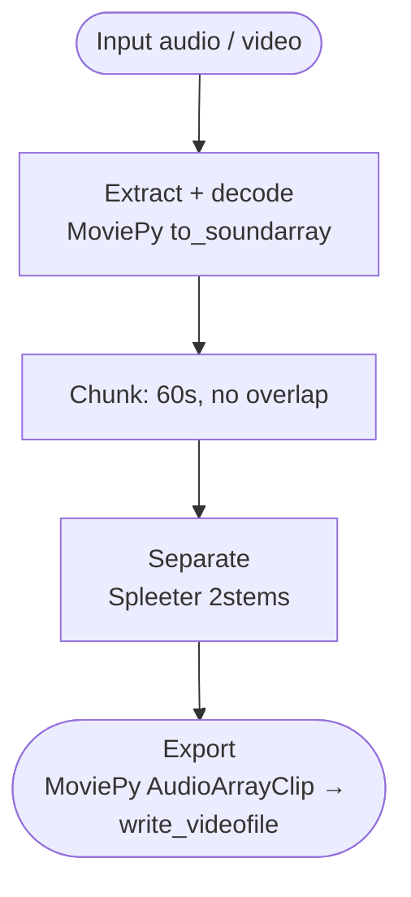

The whole app in four stages: no pre-filter, no post-filter, one hard-coded
engine, no chunk overlap.

---

## v0.1.0 — FFmpeg rewrite

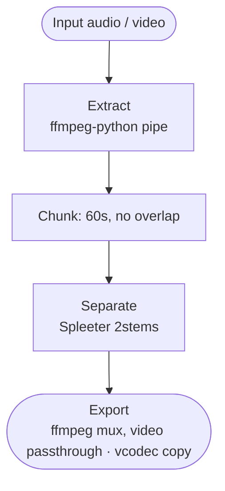

Same shape as v0.0.1. What changed: extraction and export both move off
MoviePy onto direct FFmpeg calls (faster, more reliable), and video files
are supported end to end for the first time.

---

## v0.3.0 — video & subtitles

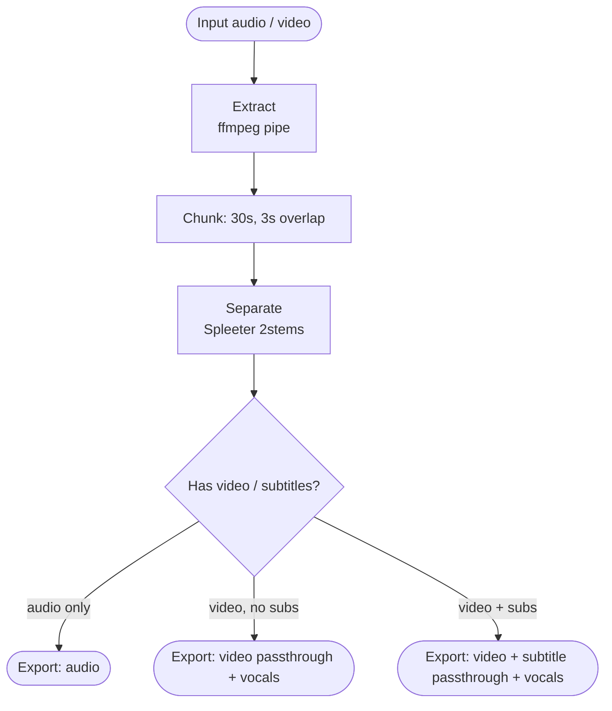

First appearance of chunk overlap (3s, reduces seam artifacts at chunk
boundaries) and of a branching export: subtitle tracks are now preserved and
the video stream is stream-copied instead of re-encoded, so quality and time
aren't spent on picture the app never touches.

---

## v0.3.3 (and v0.3.4) — Enhanced DSP Edition

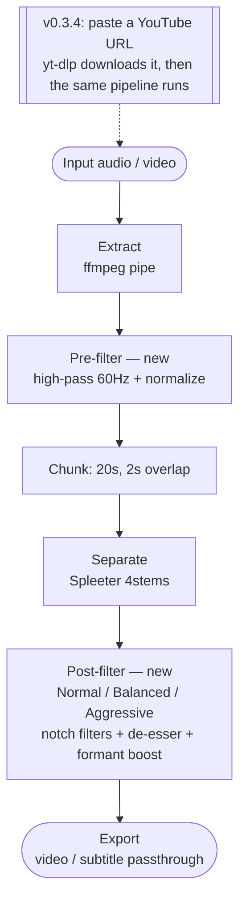

First pre-filter and first post-filter stage in the project's history, each
its own function. Spleeter switches from 2-stem to 4-stem. v0.3.4 adds
nothing to the pipeline itself — it's a new *input* path (paste a URL
instead of browsing for a file) feeding the identical v0.3.3 pipeline.

> ⚠️ **Docstring/code mismatch, v0.3.3 and v0.3.4.** The module docstring
> advertises "6 advanced post-processing techniques." That refers to an
> `AudioProcessor` class in the file (de-esser, spectral subtraction, formant
> enhancement, voice-activity detection, adaptive gating, a multiband
> compressor) — and none of its six methods are ever called. The pipeline
> that actually runs is the simpler `Normal / Balanced / Aggressive`
> mode-dispatch shown above.

---

## v0.4.0 — pivot to Demucs

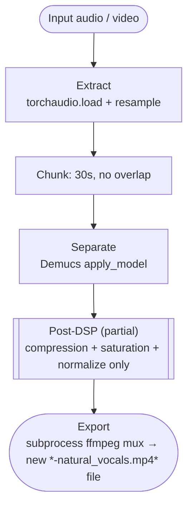

The first version to use a true neural source-separation model instead of
Spleeter/DSP alone — and a near-total rebuild of the I/O around it:
extraction moves from ffmpeg-python to `torchaudio.load`, export moves from
ffmpeg-python to a raw `subprocess` call, and chunk overlap is dropped
entirely (a regression from v0.3.x, fixed again in v0.4.1).

> ⚠️ **Docstring/code mismatch, v0.4.0.** A comment labels this stage
> "De-esser + EQ cleanup (<80Hz rumble, >12kHz artifacts)," but that part of
> the function is an unexecuted placeholder comment
> (`# Basic butterworth filters would go here`) — no filter ever runs. Only
> compression, tanh saturation, and peak normalization actually execute.

A separate, unrelated mode (`simple_deaudio`) can strip all audio from a
file for a video-only output. It's a different operation entirely, not a
branch of this pipeline.

---

## v0.4.1 (and v0.4.2) — selectable engines return

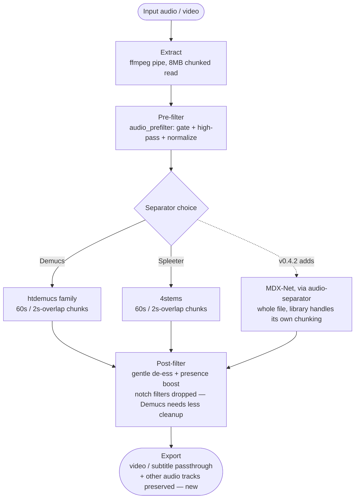

`audio_prefilter` and the post-filter both become standalone, reusable
functions here (previously inline or absent). First version with a real
engine *choice* behind a dropdown — Demucs or Spleeter in v0.4.1, with
MDX-Net added as a third option in v0.4.2 and nothing else changed. Export
now preserves other original audio tracks (e.g. dub languages), not just
subtitles.

---

## v0.4.2-RT — experimental DSP → AI → DSP branch

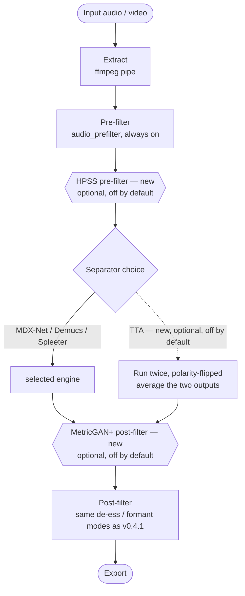

A research/testing branch, never promoted wholesale: `librosa.effects.hpss`
splits out the harmonic content before separation, and SpeechBrain's
MetricGAN+ cleans the vocals stem after. Also adds test-time augmentation
(run the separator twice, average) as a third optional wrapper. No VAD gate
exists anywhere in this branch.

This is the one file in the whole history whose docstring **matches its code
exactly** — called out for contrast with the two mismatches above.

---

## v0.4.4 — VAD gate + learned cleanup

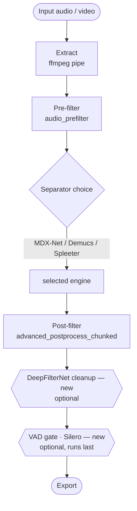

First appearance of a VAD gate and a learned post-separation enhancer
anywhere in this project. Both land *after* the DSP post-filter; the VAD
gate deliberately runs last of all, because DeepFilterNet needs a
continuous signal to build its noise model, and gating first would fragment
the audio before DeepFilterNet ever saw it. This is the shape of the
binaries currently published under the [v0.4.4 release](https://github.com/mAbEngineers/Music-Assassin/releases/tag/v0.4.4).

---

## v0.4.5 — current (fast engine + keep sound effects)

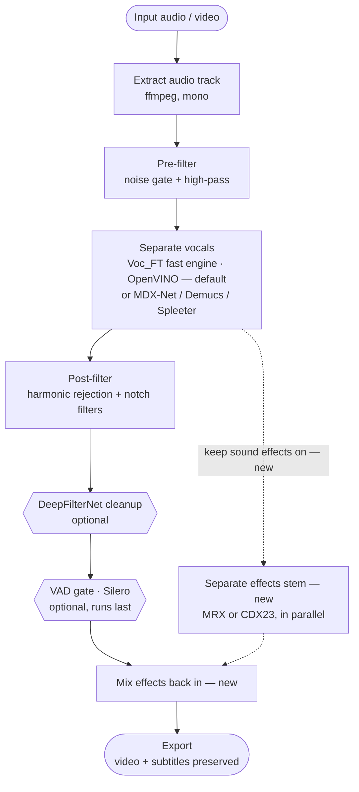

Same backbone as v0.4.4. What's new: two faster separator choices (the
OpenVINO-accelerated Voc_FT fast engine, now default, and MRX dialogue), and
the "keep sound effects" branch — a parallel separation call that extracts
an effects stem and mixes it back in after the VAD gate, scaled to sit at
roughly its original level relative to the dialogue. Not yet on the
releases page as prebuilt binaries as of this writing; see the README's
[Download](../README.md#-download) section for current status. This
diagram is identical to the one in the README's
[Pipeline section](../README.md#-pipeline).

---

## v0.5.0 (and v0.5.1) — parked streaming experiment

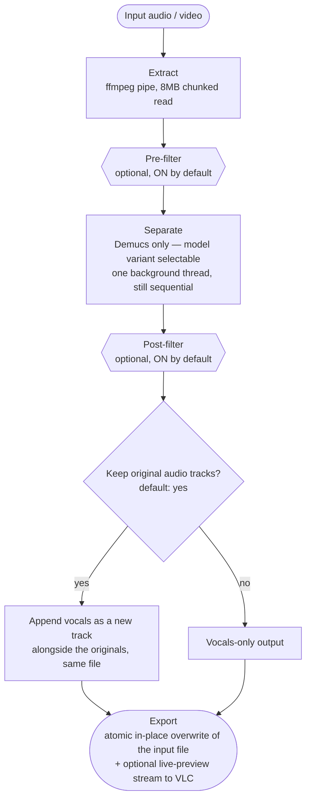

A separate architectural branch, not a continuation of the v0.4.x line (see
`CHANGELOG.md`'s note on the version numbers). The only point in this
history where the engine choice collapses back to Demucs-only, where the
pre-/post-filters become optional instead of unconditional (though still on
by default), and where the result **overwrites the original file in place**
rather than writing a new `-vocals` sidecar. Also adds a live-preview
FIFO/HTTP stream and a small local IPC server for an external VLC
integration — both outside the per-file pipeline itself.

v0.5.1 keeps this exact shape. Its only changes are the same two audio bugs
v0.4.1 independently found and fixed on the other branch: per-chunk
normalization (caused end-of-file static) replaced with one global
normalization pass, and a hard end-of-file cutoff replaced with a fade to
silence.
